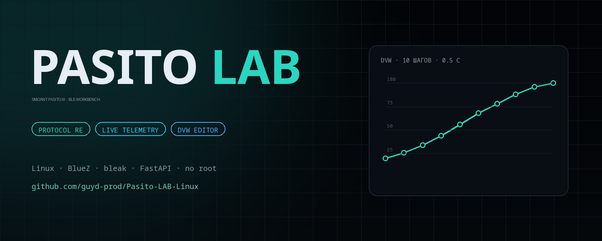
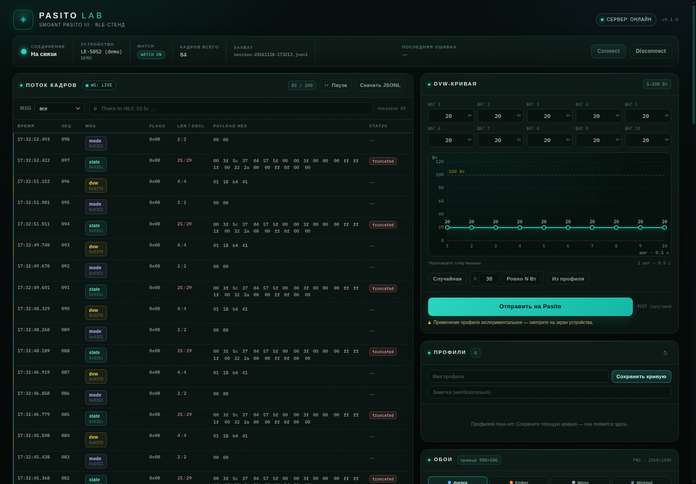
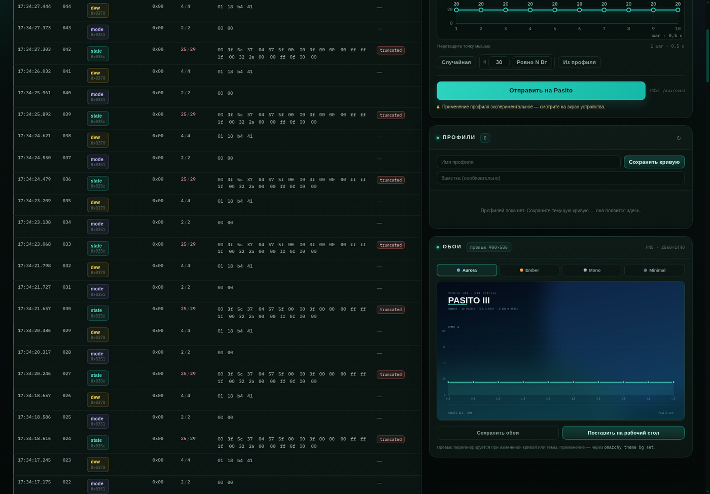
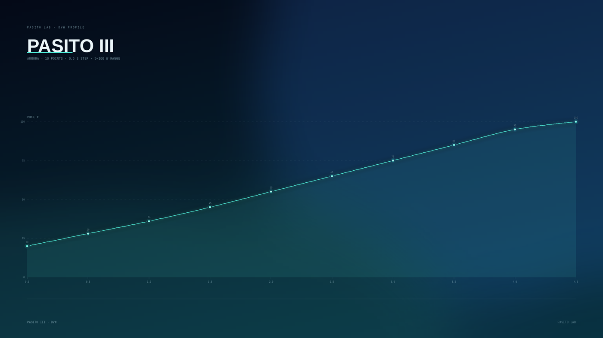
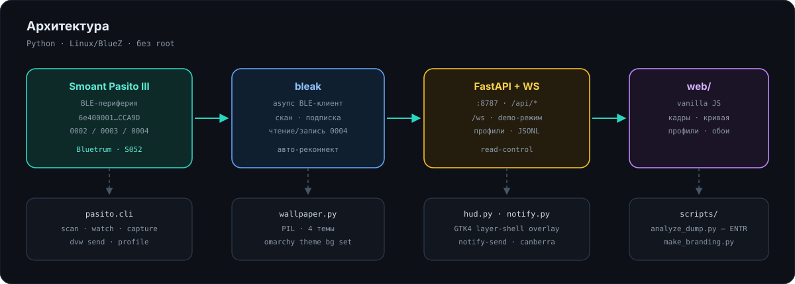
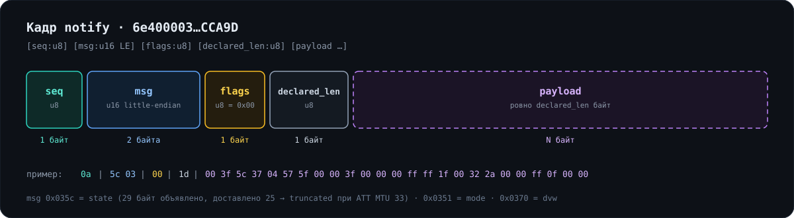

<p align="center">
  
</p>

<h1 align="center">Pasito Lab Linux</h1>

<p align="center">
  <b>BLE-стенд для Smoant Pasito III (S052)</b>: реверс протокола, живой поток кадров, DVW-редактор,<br>
  генератор обоев, HUD-оверлей и утилиты для аппаратного разбора.
</p>

<p align="center">
  <a href="https://github.com/guyd-prod/Pasito-LAB-Linux/actions/workflows/tests.yml"></a>
  
  
  
  
  
</p>

---

## Скриншоты

**Дашборд** — живой поток кадров, DVW-кривая с перетаскиванием точек, профили, отправка на устройство:

<p align="center">
  
</p>

**Обои** — генерируются из вашей кривой прямо в браузере и ставятся на рабочий стол:

<table>
  <tr>
    <td width="50%"></td>
    <td width="50%"></td>
  </tr>
</table>

**Архитектура**

<p align="center">
  
</p>

## Что это

Linux-инструментарий для BLE-вейпа **Smoant Pasito III (S052)**, заменяющий
macOS-лабораторию и добавляющий работу на Linux (BlueZ), веб-дашборд, генератор обоев,
HUD и демо-режим без устройства.

Всё, что заявлено, подтверждено на живом устройстве: скан, подключение, подписка на `0003`,
приём кадров, чтение/запись 512-байтового буфера `0004`, отправка DVW-профиля.

## Что подтверждено на живом устройстве

- BLE-сервис один: `6e400001-b5a3-f393-e0a9-e50e24dcca9d` (клон Nordic UART с `9D` на конце);
  характеристики `0002` write-without-response, `0003` notify, `0004` read/write.
- После подписки на `0003` устройство **само** присылает три кадра: `0x035c` (state),
  `0x0351` (mode), `0x0370` (dvw).
- `0004` — **буфер 512 байт**, а не двухбайтовое поле.
- Сессию устройство закрывает само: ~13 с простоя или сразу после чтения `0004`.
- Реклама: manufacturer ID `0x0642` = **Bluetrum**, service data `00003802` = MAC устройства.
- Кадр DVW-профиля: `02` + 10 байт, 1 байт ≈ ватты (диапазон 5–100 Вт).
- Официального приложения и OTA/DFU у Pasito III нет; экран — 1.3" TFT с 24 готовыми обоями,
  но канала загрузки своих обоев на устройство не существует.

Полный разбор и открытые вопросы: [docs/PROTOCOL.md](docs/PROTOCOL.md).

## Возможности

| Возможность | Где |
|---|---|
| Скан BLE, фильтр кандидатов Pasito, RSSI, manufacturer/service data | `pasito scan` |
| Живой поток кадров с автопереподключением | `pasito watch`, дашборд |
| Запись потока в JSONL (весь сеанс) | `pasito capture`, `/api/capture/download` |
| Чтение 512-байтового `0004` и запись произвольных байт | `pasito read-control`, `write-control`, `write-rx` |
| Отправка DVW-кривой `02+10` с ATT-подтверждением | `pasito dvw send`, дашборд |
| Редактор 10 точек + профили (сохранение/загрузка) | дашборд, `pasito profile` |
| Обои рабочего стола из кривой (4 темы) | `pasito wallpaper`, `/api/wallpaper` |
| Уведомления и звуки | `pasito.notify` |
| HUD-оверлей поверх окон (GTK4 layer-shell) | `pasito hud` |
| Демо-режим без устройства (реплей реальных кадров) | `pasito serve --demo` |
| Разбор дампа флеша (ресурсы `ENTR`, картинки) | `scripts/analyze_dump.py` |

## Быстрый старт

```sh
git clone https://github.com/guyd-prod/Pasito-LAB-Linux.git
cd Pasito-LAB-Linux

python3 -m venv .venv
.venv/bin/pip install -r requirements.txt

./run.sh scan      # найти LE-S052 (Pasito должен быть разбужен: экран → меню Bluetooth/Share)
./run.sh watch     # живой поток кадров в терминале
./run.sh serve     # дашборд: http://127.0.0.1:8787
./run.sh serve --demo   # дашборд без устройства, на реплее реальных кадров
```

Требования: Linux + BlueZ 5.5x+, Python 3.11+. Root не нужен.

## Протокол

Кадр notify `6e400003`:

<p align="center">
  
</p>

| Кадр | msg | declared_len | payload (факт) | Повторяемость |
|---|---|---|---|---|
| state | `0x035c` | 29 | 25 | байт-в-байт одинаков между сессиями |
| mode | `0x0351` | 2 | 2 | `00 00` |
| dvw | `0x0370` | 4 | 4 | `01 18 b4 41` |

Большой кадр приходит усечённым (ATT MTU = 33): 5 байт заголовка + 25 payload, хотя объявлено 29.
Семантика полей payload ещё не расшифрована — см. план экспериментов в
[docs/PROTOCOL.md](docs/PROTOCOL.md).

## CLI

```text
pasito scan            [--timeout 8] [--all] [--json]
pasito watch           [--address MAC]
pasito capture         [--seconds 30] [--out FILE] [--address MAC]
pasito read-control    [--hex] [--address MAC]
pasito write-control   HEX... [--no-response] [--read-back]
pasito write-rx        HEX...
pasito dvw send        --values 20,30,... | --profile NAME [--handshake] [--json]
pasito profile         list | add --name N --values ... | rm --id ID | show --id ID
pasito wallpaper       --values ... | --profile NAME [--theme aurora] [--out FILE] [--apply]
pasito serve           [--port 8787] [--demo]
pasito hud             [--url http://127.0.0.1:8787/api/state]
```

## Обои, уведомления, HUD

```sh
./run.sh wallpaper --values 20,30,40,50,60,70,80,90,100,100 --theme aurora --apply
./run.sh hud --url http://127.0.0.1:8787/api/state
```

- Обои: 4 темы (`aurora`, `ember`, `mono`, `minimal`), PNG 2560×1440, применение через
  `omarchy theme bg set` (fallback — `swww`).
- Уведомления: `notify-send` (quickshell), звуки — canberra/paplay; события подключения,
  отключения, отправки профиля и высокого пика мощности.
- HUD: GTK4-оверлей через `gtk4-layer-shell`, fallback — окно без декора; опрос `/api/state` раз в секунду.

## Данные

```text
~/.local/share/pasito-lab/profiles.json          профили DVW
~/.local/share/pasito-lab/captures/*.jsonl       журналы сессий
~/.local/share/pasito-lab/wallpapers/*.png       сгенерированные обои
```

## Тесты и CI

- `pytest` — **96 тестов**, покрывают протокол, хранение, обои, уведомления и HUD-хелперы.
- GitHub Actions (`tests`) гоняет их на Python 3.11/3.12/3.13 и делает smoke-тест CLI.

```sh
PASITO_NOTIFY=0 .venv/bin/python -m pytest tests/ -q
```

## Аппаратный путь: обои на самом устройстве

Свои обои на Pasito загрузить по BLE нельзя, но есть аппаратный путь: дамп SPI-флеша,
ресурсный blob Bluetrum `ENTR` (32-байтовые записи: имя/адрес/длина, XIP с `0x11000000`),
сырые RGB565-картинки. Пошаговый гид, безопасность, BOM и анализатор дампа:

- [docs/HARDWARE.md](docs/HARDWARE.md)
- [scripts/analyze_dump.py](scripts/analyze_dump.py)

## Безопасность и ограничения

- Запись `02+10` — **экспериментальная**: ATT-подтверждение означает, что запись принял BLE-стек,
  а не что устройство применило профиль. Проверяйте экран Pasito.
- Значения мощности держите в 5–100 Вт; кодирование допускает 0–255, но это не диапазон устройства.
- Не запускайте одновременно несколько клиентов к одному адаптеру/устройству.
- Обои на ПК — да; загрузка своих обоев в Pasito — только через прошивку флеша (с рисками).
- Эксперименты — только со своим устройством.

## Troubleshooting

| Симптом | Причина/решение |
|---|---|
| «не найден в эфире» | Pasito погасил BLE вместе с экраном — разбудите, откройте меню Bluetooth/Share |
| Сессия обрывается через ~13 с | Так ведёт себя устройство; клиент переподключается автоматически |
| `read-control` рвёт сессию | Чтение `0004` завершает сессию на устройстве — это не ошибка |
| Пустой поток кадров | Нужна подписка на `0003`: `watch`/дашборд делают это сами |
| Не ставится обои | Нужен Omarchy/quickshell: `omarchy theme bg set <file>`; иначе путь просто сохраняется |

## Структура

```text
pasito/proto.py       протокол: UUID, кадры, DVW-кодек
pasito/ble.py         async-клиент bleak: скан/подключение/подписка/запись
pasito/store.py       профили, журналы, пути данных
pasito/cli.py         CLI
pasito/server.py      FastAPI + WebSocket + демо-режим
pasito/wallpaper.py   генератор обоев (PIL) + применение
pasito/notify.py      уведомления и звуки
pasito/hud.py         GTK4-оверлей (layer-shell)
web/                  дашборд (vanilla JS)
scripts/              analyze_dump.py (ENTR/картинки), make_branding.py (баннер, логотип)
docs/CONTRACT.md      API и модели
docs/PROTOCOL.md      результаты реверса протокола
docs/HARDWARE.md      аппаратный путь к своим обоям
docs/images/          скриншоты и схемы
assets/brand/         баннер, логотип, social preview
tests/                pytest
```

## Лицензия

Лицензия пока не указана. Если планируете переиспользование — откройте issue или добавьте MIT.
